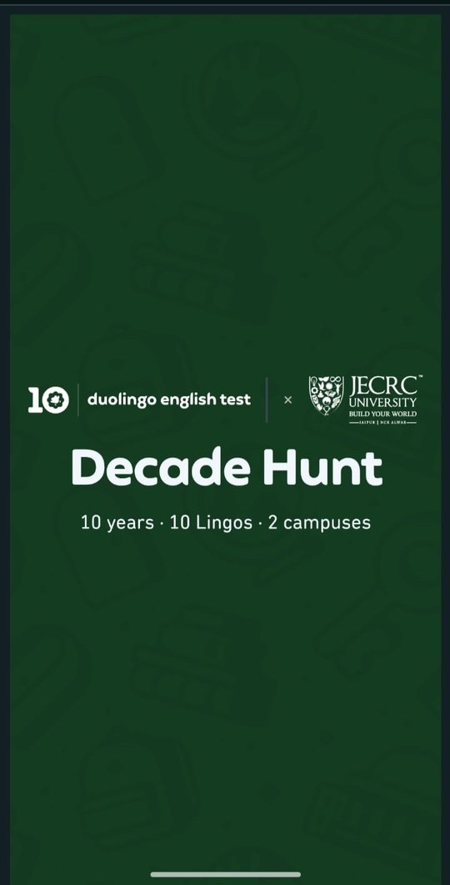
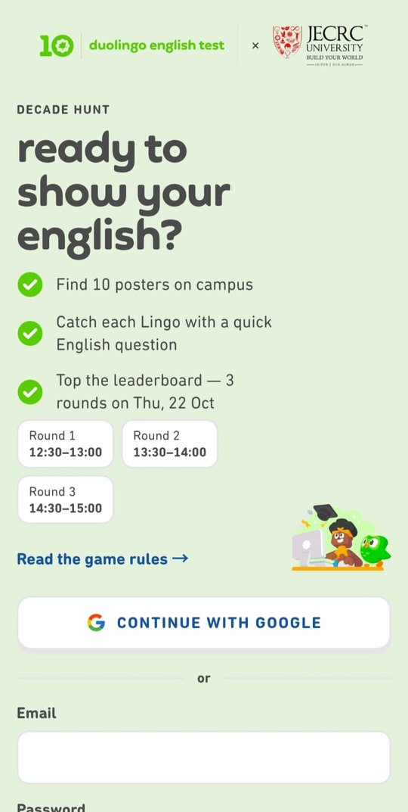
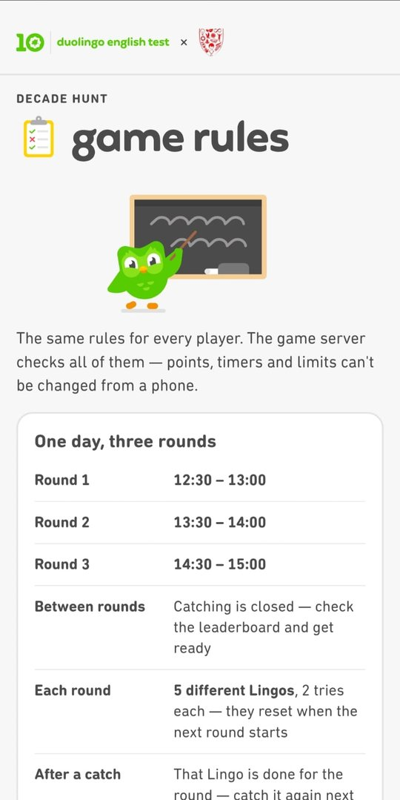
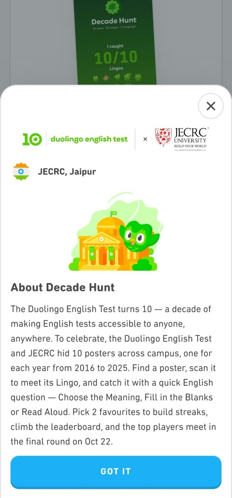
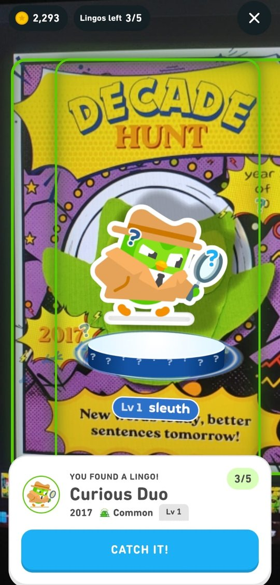
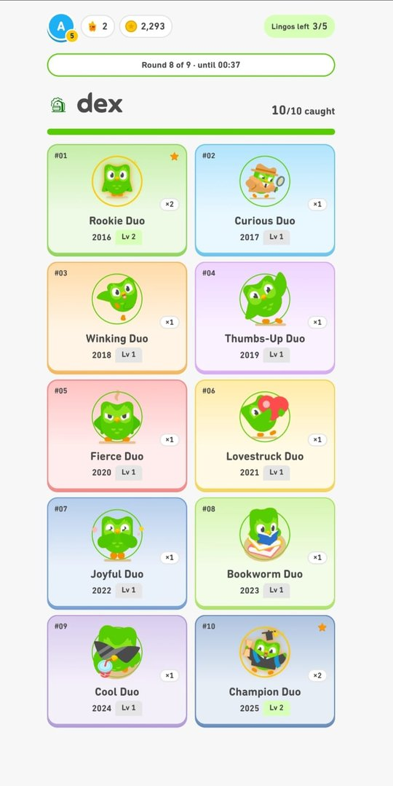
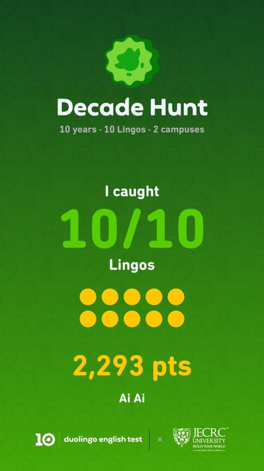

# Decade Hunt

A campus augmented-reality game, built for the Duolingo English Test's 10-year celebration at JECRC
University, Jaipur. Players find posters around campus and point their phone at one: a creature
(a "Lingo") appears on the camera. They catch it by answering a quick English question, either
reading a word aloud or picking a word's meaning, and climb a live leaderboard.

> **Official Duolingo / DET brand assets are not included in this repository.** The screenshots
> below show the official look used at the event. A clone of this repo runs with its own placeholder
> look; see [Run it with the placeholder brand](#run-it-with-the-placeholder-brand).

## Screenshots

<table>
  <tr>
    <td align="center"><br><sub>Splash</sub></td>
    <td align="center"><br><sub>Login with the day's rounds</sub></td>
    <td align="center"><br><sub>Game rules</sub></td>
    <td align="center"><br><sub>About</sub></td>
  </tr>
  <tr>
    <td align="center"><br><sub>AR scan on a poster</sub></td>
    <td align="center"><br><sub>Dex and the round line</sub></td>
    <td align="center"><br><sub>Share card</sub></td>
    <td></td>
  </tr>
</table>

## Features

- **AR posters.** Image tracking ([MindAR](https://github.com/hiukim/mind-ar-js)) places a Lingo on
  each of the 10 posters. It's a paper-standee in three.js, with a look for each level.
- **English challenges.** Read aloud (browser speech recognition, `en-IN`), word meanings and
  fill-in-the-blanks, from a pool of 456 questions in two levels. Questions are timed by the server.
- **Progression.** Levels Lv 1 → Lv 2 → MAX, 2 favourites with streaks, a Dex of all 10 Lingos, and
  points with speed bonuses.
- **One-day event mode.** Three timed rounds instead of days, with a live round line. A 3-round
  demo can be started from the admin page before the event.
- **Owl Raids.** Timed group catches that unlock when enough players join.
- **Staff tools.**
  - `/admin`: config, question upload, prizes, suspicious players, a top-20 CSV export, and lock /
    unlock.
  - `/stage`: a projector screen with a countdown, the live top 10 and a sudden-death question.
  - `/redeem`: a prize desk that scans the player's QR code.
- **Anti-cheat.** The phone never writes to the database. All points are calculated on the server,
  answers are never sent before the player answers, Firebase App Check is enforced, and there are
  rate limits, speed / voice / location flags and possible-duplicate detection.

## Tech stack

| Part | Built with |
|---|---|
| Web app (`web/`) | React 18, Vite, TypeScript, react-router, Firebase JS SDK, three.js + MindAR |
| Backend (`functions/`) | Firebase Cloud Functions v2 (Node 20, TypeScript), region `asia-south1` |
| Data & auth | Cloud Firestore, Firebase Auth (Google + email/password), App Check (reCAPTCHA Enterprise) |
| Hosting | Firebase Hosting |
| Shared types | `shared/types.ts` (one source for data shapes and function I/O) |
| Tests | Vitest (unit, emulator, Firestore rules), Playwright end-to-end (Chromium + WebKit) |

## Run it with the placeholder brand

Needs Node 20+ and the Firebase CLI (`npm i -g firebase-tools`). Everything runs on the local
Firebase emulators, so no Firebase project or keys are needed.

1. In `web/src/config/brand.ts` change one line to
   `export const ACTIVE_BRAND = "placeholder" as "official" | "placeholder";`. The app then uses its
   own colours, fonts and creatures.
2. Install: `npm install` in `web/`, `functions/` and `scripts/`.
3. Start the emulators and seed them, then start the web app (see the commands just below).
   `web/.env.development` already points the app at the emulators. Open http://localhost:5173 and
   sign up with any email.

Without the poster targets (`assets/targets.mind`) the Scan screen shows an error. The other
screens and the end-to-end tests (which use a fake scanner) work. What the official files are and
where they go: [assets/brand/README.md](assets/brand/README.md).

## Project docs

What to build: [docs/SPEC.md](docs/SPEC.md). Security and anti-cheat: [docs/SECURITY.md](docs/SECURITY.md).
The one-day event: [docs/ONE-DAY-EVENT.md](docs/ONE-DAY-EVENT.md). Working rules: [CLAUDE.md](CLAUDE.md).

## Run it locally

```bash
firebase emulators:start                # Auth 9099, Firestore 8085, Functions 5001, Hosting 5000, UI 4000
npx tsx scripts/seed.ts                 # 10 Lingos, config (both campuses), question pool, prizes
npx tsx scripts/testUsers.ts            # admin@qa.test, volunteer@qa.test, player1–5@qa.test (password test1234)
cd web && npm run dev                   # http://localhost:5173 (and http://<laptop-ip>:5173 on the same Wi-Fi)
```

## Tests

| What | Command | Needs |
|---|---|---|
| Unit (scoring, matching, dates, anti-cheat helpers) | `cd functions && npm test` | — |
| Emulator (every function, Firestore rules, security) | `cd functions && npm run test:emu` | emulators running + seeded |
| End-to-end, Chromium + WebKit at 375×812 | `cd e2e && npm install && npm run install-browsers && node run.mjs` | emulators + `npm run dev` |
| Colour contrast | `cd web && npx tsx scripts/check-contrast.ts` | — |

`node run.mjs --browser=webkit 03` runs one flow in one browser. Screenshots and logs go to `e2e/out/`.
The E2E flows mock the camera (`window.__posterFound(i)`), microphone, location and speech. The fake
scanner only exists when the app runs against the emulators.

## App Check (do this before going live)

The functions **refuse every call without an App Check token** (anti-cheat D). The web app gets its
tokens from **reCAPTCHA Enterprise** (`ReCaptchaEnterpriseProvider` in `web/src/lib/firebase.ts`),
which is invisible to players. One-time setup:

1. **reCAPTCHA Enterprise key.** Google Cloud console (project `decade-hunt-66f6e`) → *Security* →
   *reCAPTCHA* → *Create key*: platform **Website**, domains `decade-hunt-66f6e.web.app`,
   `decade-hunt-66f6e.firebaseapp.com` (and any custom domain), **score-based** (no checkbox
   challenge). Copy its **key ID**. There is no secret key with Enterprise.
2. **Register the app.** Firebase console → *App Check* → *Apps* → the web app →
   *reCAPTCHA Enterprise* → paste the **key ID** → Save (keep the default score threshold, 0.5).
3. **Key ID in the build.** In `web/.env` (git-ignored), set `VITE_RECAPTCHA_SITE_KEY=<key ID>`
   (same variable name as before). Then build and deploy Hosting (see Deploy below).
4. **Firestore enforcement.** Firebase console → *App Check* → *APIs* → *Cloud Firestore*. First
   watch the metrics for about an hour after launch: almost all requests should show as *verified*.
   Then press **Enforce**. Cloud Functions are already enforced in code; there's no console switch
   for them.
5. **Testing a preview from a desktop (optional).** App Check → *Apps* → ⋮ → *Manage debug tokens*
   → add a token. Put it in `VITE_APPCHECK_DEBUG_TOKEN` for that test build only. Never set it for
   the live build. Preview channel domains (`decade-hunt-66f6e--<name>.web.app`) aren't in the
   reCAPTCHA list, so they need this debug token, or add the preview domain to the key.

**Emergency switch.** If App Check blocks real players (for example a reCAPTCHA outage), create
`functions/.env.decade-hunt-66f6e` with `ENFORCE_APP_CHECK=false` and run
`firebase deploy --only functions -P prod`. Remove the line and redeploy afterwards.

On the emulators, App Check uses an unsigned debug token, so local play and tests need no setup.

## Deploy (only after the day's checks pass)

Billing (Blaze) must be on for Cloud Functions. Production project: `decade-hunt-66f6e` (alias `prod`).

```bash
cd functions && npm test && cd ..                         # unit tests
firebase deploy --only firestore:rules,firestore:indexes -P prod
firebase deploy --only functions -P prod                  # needs Blaze
GOOGLE_APPLICATION_CREDENTIALS=key.json npx tsx scripts/seed.ts --prod --project decade-hunt-66f6e --real-dates
GOOGLE_APPLICATION_CREDENTIALS=key.json npx tsx scripts/loadQuestions.ts --prod --project decade-hunt-66f6e
cd web && npm run build && cd ..                          # with VITE_RECAPTCHA_SITE_KEY set in web/.env
firebase deploy --only hosting -P prod
GOOGLE_APPLICATION_CREDENTIALS=key.json npx tsx scripts/setRole.ts <your-email> admin --prod --project decade-hunt-66f6e
```

`key.json` is a service-account key. Never commit it.
